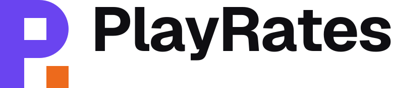

# PlayRates logo

**The idea:** the full stop is the verdict. The square knocked out of the P
drops to the baseline as the last word on a game. The counter and the stop are
the same square, and that square is the unit everything else is measured in.

The masters here are the source. `npm run brand-assets -w frontend` draws the
favicon, home-screen icons, link-preview card, avatars and banners from them;
run it after changing anything in this folder.

## Versions

|                                           | Light backgrounds                                  | Dark backgrounds                 |
| ----------------------------------------- | -------------------------------------------------- | -------------------------------- |
| Horizontal (primary)                      | `lockup-horizontal.svg`                            | `lockup-horizontal-reversed.svg` |
| Stacked                                   | `lockup-stacked.svg`                               | `lockup-stacked-reversed.svg`    |
| Symbol                                    | `symbol.svg`                                       | `symbol-reversed.svg`            |
| Wordmark (no room for the symbol)         | `wordmark.svg`                                     | `wordmark-reversed.svg`          |
| On an iris background                     | `symbol-on-iris.svg`, `lockup-stacked-on-iris.svg` |                                  |
| App icon                                  | `app-icon.svg` (the tile is part of the artwork)   |                                  |
| One colour (print, embroidery, engraving) | `one-colour/*-black.svg`                           | `one-colour/*-white.svg`         |

The wordmark is set in Geist (SIL Open Font License, so logo use is fine) and
outlined. Its full stop is drawn, not typed. Never retype it.

## Small sizes

Below 48px use the **small cut** (`symbol-small.svg`, `app-icon-small.svg`).
It's redrawn on a 16-unit grid so every edge lands on a whole pixel at 16, 32
and 48px. The full symbol blurs at those sizes, and the gap above the stop
closes up.

| Version           | Minimum                                   |
| ----------------- | ----------------------------------------- |
| Horizontal lockup | 96px wide · 25mm print                    |
| Symbol            | 24px (small cut down to 16px) · 6mm print |

## Clear space

Keep **one stop** clear on every side: the width of the orange square at the
size the logo is used. It scales with the logo.

## Colour

|            | HEX       | RGB         | CMYK (approx.) | Use                           |
| ---------- | --------- | ----------- | -------------- | ----------------------------- |
| Iris       | `#6A44F0` | 106 68 240  | 56 72 0 6      | The P; the app-icon tile      |
| Ember      | `#FF8438` | 255 132 56  | 0 48 78 0      | The stop, on dark and on iris |
| Ember deep | `#ED6A1C` | 237 106 28  | 0 55 88 7      | The stop, on light            |
| Ink        | `#0F0E12` | 15 14 18    | 100% K         | The name, on light            |
| Paper      | `#F4F2F8` | 244 242 248 | none           | The P and the name, on dark   |

Iris is brighter than CMYK can print. For spot colour, the nearest coated
Pantones are about 2725 C (iris) and 1575 C (ember). Check them against a
physical swatch book before anything goes to print.

The stop is never the only thing that identifies the mark. Ember on iris
(2.3:1) and ember deep on the light page (2.8:1) are decorative contrast. The
P carries the logo: iris on the page is 5.0:1, and white on iris is 5.7:1.

**Approved pairs:** iris + ember deep on the light page or white · paper +
ember on ink · white + ember on iris · black or white alone.

## Don't

- Stretch, rotate or skew it, or add shadows, outlines, gradients or glows.
- Recolour the stop to anything but ember or the one colour the rest is in.
- Move the stop, resize it, or round its corners. It's the same square as the counter.
- Swap Geist's own round full stop into the wordmark.
- Put it on a photo or a busy background without the app-icon tile behind it.
- Rearrange or resize the parts of a lockup.

## Also here

- `presentation/board.html`: the presentation board with mockups (app icon,
  tab, site, profile, sticker, T-shirt). Open it in a browser.
- `../`: generated avatars, banners and lockup PNGs for uploading by hand.
